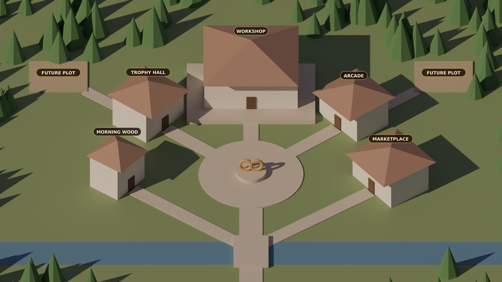

# The village: how we build it properly

The landing page is an interactive village. This is the plan, from four research passes: layout design, art pipeline,
web tech, and our own workshop scene's code. Nothing gets generated or built until the owner approves the layout below.

## What went wrong the first time

- **Art before layout.** We generated a background with pads and then made buildings to fit, so camera angles
  drifted and nobody had decided which way each door faced.
- **A camera rule we broke.** The camera looks from the south. A building south of the plaza can't face the plaza
  without showing us its back. The two lower buildings could never have worked.
- **Cramped middle, empty edges.** Small pads in the middle, a lot of forest around them.

## The layout (approved first, before any art)

A horseshoe around the plaza. This is how polished game hubs and Disney's hub-and-spoke work: one landmark at the end
of the main road, everything else facing the middle.

- **Workshop** at the top of the main road, on a raised terrace, biggest and brightest. Door faces straight down the
  steps to the plaza.
- **Trophy Hall** (upper left) and **Arcade** (upper right) curve around the back of the plaza. Doors face the
  plaza.
- **Morning Wood** (left) and **Marketplace** (right) sit at the sides, turned toward the front of the plaza where the
  road comes in. Their doors show clearly to the camera.
- **The plaza** with the infinity sculpture in the middle. The burn tally sits on its plinth.
- **Nothing with a door goes below the plaza.** That area is the road in, the bridge, the stream and trees.
- **Two future plots** up the hill behind Trophy Hall and Arcade, drawn as dressed construction sites (scaffolding,
  crates), not "coming soon" signs. A later district can go across the stream with a second footbridge.
- **Sizes by importance:** Workshop 1.0, Marketplace 0.65, Arcade and Trophy Hall 0.6, Morning Wood 0.45.
- **The village fills the screen.** The river and the bridge into town run along the bottom; you cross and the road
  splits three ways (Morning Wood, the plaza and Workshop, the Marketplace). Scenery is minimal: a band of trees along
  the top and a few at the corners. Approved by the owner (the render above).

Door rules for this camera (from now on, for every building):
1. Doors go only on walls that face the camera or the side.
2. Left of the main road: the door is on the building's right-front face. Right of it: on its left-front face.
3. Every door has a path to the plaza, and nothing tall stands in front of it.
4. Buildings further back sit higher (the terrace), so their doors clear the roofs in front.
5. Future plots follow the same rules.

## The art pipeline

**The 3D blockout drives everything.** The village is built once in Blender (free; it runs here), with plain boxes,
real paths, a red marker on every door, and one locked camera (orthographic, looking down 40°, dusk light from the
upper left). Every image is made from renders of it, so the angle, sizes and doors can't drift.

From the blockout, Claude renders:
- **a clay render** (the guide for the look);
- **depth and line-art images** (for tools that follow geometry exactly);
- **an ID mask** (one flat colour per building, for perfect cut-outs and click areas);
- **shadow passes** (ground shadows as their own layer, no grey halos).

**Then the art, in one of two ways depending on the owner's computer:**

- **Route A (NVIDIA graphics card, about 8 GB or more): Krita AI Diffusion (free).** Load the depth and line-art
  renders as control layers, so the AI follows the blockout's geometry exactly. Give it one approved style frame as a
  style reference, with a fixed seed and one prompt region per building. This is the professional route: the layout
  can't drift.
- **Route B (no such card): the chat image tool, with the clay render as the reference.** "Image 1 is the exact
  layout and camera; keep every building's position, size and door exactly." It follows composition well but not
  pixel-exactly, so Claude then fits the masks and click areas to the art instead of regenerating until it matches.

**Either way, whole scene first, then buildings in place.** Generate the whole village at once (one light, matching
shadows), then redo any building by editing it in place on that image (masked edit / inpaint). Don't make buildings
separately on grey and paste them in; that's what gave us mismatched light and grey halos.

**Then Claude finishes it:**
1. Cut each building out using the ID mask, with clean edges and no halos.
2. Make the empty-ground version behind each building (that's also a future plot's look).
3. Upscale, apply one colour grade to every layer, and export AVIF/WebP in screen-size tiers.
4. Write a small data file: each building's outline, door point, sign position and link.

**Adding a building later:** add a box on a plot in the blockout, render its masks, edit it into the current scene,
grade it and cut it. One new layer and a few lines of data; nothing else changes.

**Seasons (snow, festival):** a light edit over the finished village with the same guides. Outlines stay put, so the
click areas carry over.

## The interactive page

- **Drawing:** one PixiJS canvas (free, fast on phones). All words and buttons are normal page elements on top, so
  text stays sharp and screen readers and keyboards work.
- **On hover or tap:** the building gets a warm brass outline glow, lifts a few pixels and brightens a touch. Its own
  little animation speeds up (chimney puffs, the sign swinging). On phones, the first tap selects and shows its sign
  with an Enter button; the second tap goes in.
- **Live signs:** "On sale · 132 left", "2 offers on your cards", "Today's issue is out", "Prize run live".
- **Going in:** the camera eases toward the building and zooms, the door glows, then the inner screen fades in. Back
  plays it in reverse.
- **Alive, but cheap:** chimney smoke, lamp flicker, water shimmer, fireflies at dusk, a few swaying trees, one cart
  on the road, an occasional bird. Not a crowd of walking people (that's a known time sink).
- **Phones:** the village fills the top two thirds, opening on the plaza, with drag and pinch to look around. A row
  of big Places buttons sits under it with the same live badges, so nobody has to hunt.
- **Always:** the main button stays fixed at the bottom ("On sale now", or "Open packs" only when the wallet has
  packs that can open). Calm mode and reduced-motion respected; a plain list of links for screen readers. If WebGL
  isn't available it falls back to the still picture with buttons, like the workshop today.
- **Loading:** a tiny blurred preview first, then the right-size picture, then the buildings, then the effects.

## Order of work

1. **Owner approves the layout** (the blockout render above), or asks for changes. Claude re-renders in minutes.
2. **Style frame:** one image of the whole village in the look we want, made from the clay render.
3. **The final scene,** by route A or B, then building-by-building fixes in place.
4. **Claude cuts, grades and exports,** and builds the page in phases:
   - **1:** still picture, signs, click areas, glow, phone layout.
   - **2:** PixiJS, pan and zoom, smoke, lamps, water.
   - **3:** the zoom-into-building transition, sounds, fireflies, live badges.
   - **4:** seasons and new buildings.
5. **Owner reviews each phase** on a phone and a computer before anything is pushed.

## Files

- `web/art/factory/village/blockout/village.py`: the blockout (Blender script; run with the `bpy` package).
- Renders and masks: generated from the script, not hand-made.
